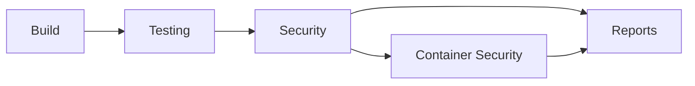

# QodanaExampleNodejs

An **intentionally vulnerable Node.js REST API** paired with a security pipeline in Azure Pipelines
and two GitHub Actions workflows.

The app contains security bugs on purpose, so you can see which tool in the pipeline catches
which kind of problem. Some bugs are still in the code; others were found by the pipeline and
fixed, and the fixes are documented in [`server.js`](server.js).

> [!WARNING]
> **Do not deploy this application.** It still has a hard-coded secret, path traversal
> (blocked only by the runtime hardening), error disclosure and an admin endpoint with no
> authentication. It is for training and for testing security tooling only.

---

## Contents

- [The application](#the-application)
- [Security coverage](#security-coverage)
- [Pipeline steps](#pipeline-steps)
- [Built-in security errors](#built-in-security-errors)
- [Running it locally](#running-it-locally)
- [Configuration](#configuration)
- [Repository layout](#repository-layout)

---

## The application

A plain Node.js `http` server ([`server.js`](server.js)) on port **8080**. Its only runtime
dependency is `lodash`.

| Endpoint | Purpose | Notes |
|---|---|---|
| `GET /api/current_time` | Current server time as ISO JSON | Also used by the Docker `HEALTHCHECK` |
| `GET /api/file?name=` | Reads a file from `./files/` | ⚠️ Path traversal, error disclosure |
| `GET /api/ping?host=` | Pings a host once | Fixed: no shell, validated host |
| `GET /api/admin` | Returns admin data | ⚠️ No authentication, leaks `API_SECRET` |
| `GET /api/token?user=` | Signed token for a user | Key comes from the `TOKEN_SIGNING_KEY` env variable |
| `GET /api/greeting?name=` | `Hello, <name>!` | Fixed: no template injection |
| `GET /api/redirect?url=` | Redirects to a **local** path | Fixed: no open redirect |

The full API is described in [`openapi.yaml`](openapi.yaml), which the OWASP ZAP scan uses.

---

## Security coverage

| Security area | What it means | Tools in this repo |
|---|---|---|
| **SAST** (static code analysis) | Finds risky code patterns without running the code | Semgrep (`p/javascript`, `p/nodejs`), ESLint + `eslint-plugin-security` |
| **SCA** (software composition analysis) | Known CVEs in dependencies | Trivy `fs` (npm), Trivy `image` (npm + Alpine OS packages) |
| **Secrets detection** | Keys, tokens and passwords in code | Trivy (current files), **Gitleaks (whole git history)**, Trivy (image layers) |
| **Container / IaC configuration** | Dockerfile and image best practices | Trivy `config`, Hadolint, Dockle (CIS Docker Benchmark) |
| **DAST** (dynamic testing) | Attacks the running app over HTTP | Nuclei (`-dast` fuzzing), OWASP ZAP API scan |
| **Supply chain** | Trust in what gets installed and built | lockfile-lint, `npm audit signatures`, `npm ci --ignore-scripts`, base image pinned by digest, Renovate, OpenSSF Scorecard |
| **SBOM & licenses** | Inventory of everything shipped, plus license review | `npm sbom` (CycloneDX), Trivy container SBOM + license reports |
| **Runtime hardening** | Limits the damage a bug can do | Node.js permission model, read-only container with all capabilities dropped |
| **Test quality** | Proves the tests actually catch bugs | Jest + coverage, fast-check property tests, Stryker mutation testing |
| **Reporting** | All findings in one place | SARIF from every scanner, merged into a `CodeAnalysisLogs` artifact |

---

## Pipeline steps

### Overview



The [`azure-pipelines.yml`](azure-pipelines.yml) stages run in order, and **jobs within a stage
run in parallel**. If a stage fails, the next stage doesn't run. The **Reports** stage always
runs, because a failed build is exactly when you want to see the findings.

**Blocks?** in the tables below means:

- ✅ a finding fails the build
- ℹ️ the step only reports
- ⚠️ the step only shows warnings

### 1. Build (`Implement`)

| Step | Tool | Security area | Blocks? |
|---|---|---|---|
| Lint `package-lock.json` | lockfile-lint ([`.lockfile-lintrc.json`](.lockfile-lintrc.json)) | Supply chain: every package from `registry.npmjs.org` over HTTPS, with an integrity hash | ✅ |
| Install dependencies | `npm ci --ignore-scripts` | Supply chain: package install scripts never run | ✅ |
| Verify package signatures | `npm audit signatures` | Supply chain: registry signatures and provenance | ✅ |
| Lint | ESLint + `eslint-plugin-security` | Code quality + SAST | ✅ errors / ⚠️ security rules |
| Syntax check | `node --check` | Build | ✅ |

### 2. Testing

| Job | Tool | What it checks | Blocks? |
|---|---|---|---|
| Unit tests | Jest + jest-junit + Cobertura | 46 tests, about 97% line coverage; results and coverage published to Azure DevOps | ✅ |
| (part of the unit tests) | fast-check | Property-based tests: thousands of generated inputs for `isValidHost` and `isSafeRedirect` | ✅ |
| Mutation tests | Stryker ([`stryker.config.json`](stryker.config.json)) | Mutation score (currently about 87%); report published as `mutation-report` | ✅ below 70% |

### 3. Security

| Job | Tool | Security area | Blocks? |
|---|---|---|---|
| Trivy SCA | `trivy fs --scanners vuln` | SCA: HIGH / CRITICAL CVEs in npm packages | ✅ |
| Trivy Secrets | `trivy fs --scanners secret` | Secrets in the current files | ✅ |
| Gitleaks | Gitleaks (full history, [`.gitleaksignore`](.gitleaksignore)) | Secrets in **every commit**, including deleted ones | ✅ |
| Hadolint | Hadolint | Dockerfile best practices | ✅ |
| Newer dependency versions | `npm outdated --long` | Dependency freshness | ℹ️ |
| SBOM | `npm sbom` (CycloneDX) | Inventory; published as `sbom` | ℹ️ |
| Semgrep SAST | Semgrep `p/javascript` + `p/nodejs` | SAST | ✅ |
| Qodana SAST | *(placeholder, scan disabled)* | – | – |

All scanners also write **SARIF** reports.

### 4. Container Security

The image is built **once**. The three jobs after it run in parallel on exactly that image,
shared as a pipeline artifact.

| Job | Step | Tool | Security area | Blocks? |
|---|---|---|---|---|
| **Build image** | Build | `docker build` (runs lint and unit tests inside) | Build | ✅ |
| **Trivy + SBOM** | Dockerfile misconfiguration | `trivy config` | Container / IaC config | ✅ HIGH, CRITICAL |
| | Image vulnerabilities | `trivy image --ignore-unfixed` | SCA (OS + npm) | ✅ HIGH, CRITICAL |
| | Secrets in image layers | `trivy image --scanners secret` | Secrets | ✅ |
| | CIS benchmark | Dockle | Container config | ✅ WARN and above |
| | Container SBOM + license reports | Trivy (CycloneDX) | SBOM & licenses | ℹ️ |
| **Smoke tests + Nuclei** | Start locked-down container | `--read-only`, `--cap-drop ALL`, `no-new-privileges`, PID and memory limits | Runtime hardening | ✅ |
| | Health check | Docker `HEALTHCHECK` | Availability | ✅ |
| | Smoke tests | `curl`: 5 endpoint checks, plus a check that the permission model blocks `/etc/passwd` | Functional + hardening | ✅ |
| | DAST | Nuclei `-dast` (fuzzes query parameters, including OAST callbacks) | DAST | ✅ medium and above, or if the container crashes |
| **OWASP ZAP** | DAST | `zap-api-scan.py` with [`openapi.yaml`](openapi.yaml) | DAST | ✅ Medium and above, or if the container crashes |

### 5. Reports

| Step | What it does |
|---|---|
| Collect SARIF | Merges the SARIF files from Trivy (files and image), Gitleaks, Hadolint, Semgrep and Nuclei into one **`CodeAnalysisLogs`** artifact. With the free **SARIF SAST Scans Tab** extension (Microsoft DevLabs) installed in your Azure DevOps organisation, they appear in a **Scans** tab of the pipeline run. |

### GitHub Actions

| Workflow | When | What it does |
|---|---|---|
| [`renovate.yml`](.github/workflows/renovate.yml) | Mon–Fri 08:30 UTC, or manually | Opens one pull request per dependency update (npm packages and the Docker base image digest), following [`renovate.json`](renovate.json) |
| [`scorecard.yml`](.github/workflows/scorecard.yml) | Every push to `main`, Mondays 07:00 UTC, or manually | OpenSSF Scorecard checks the repo's security practices; results go to the Security tab and to scorecard.dev. Information only. |

### Pipeline artifacts

| Artifact | Contents |
|---|---|
| `docker-image` | The built image (`docker save`), shared between jobs |
| `sbom` | CycloneDX SBOM of the npm dependencies |
| `container-sbom` | CycloneDX SBOM of the whole image |
| `mutation-report` | Stryker HTML / JSON report |
| `zap-report` | OWASP ZAP HTML / JSON report |
| `sarif-*` | SARIF from each scanner, one artifact per scanner |
| `CodeAnalysisLogs` | All SARIF files together (for the Scans tab) |

---

## Built-in security errors

Each bug is marked in [`server.js`](server.js) with a `SECURITY ERROR #n` comment, or with
`FIXED (was SECURITY ERROR #n …)` once fixed.

### Still in the code

| # | Error | Where | Caught by | Status in the pipeline |
|---|---|---|---|---|
| 1 | Hard-coded secret (`API_SECRET`) | `server.js` | ❌ **No tool**: the value matches none of the Trivy or Gitleaks rules | Passes undetected. A good example of the limits of pattern-based secret scanning. |
| 2 | Path traversal (`/api/file?name=../../etc/passwd`) | `/api/file` | ESLint `security/detect-non-literal-fs-filename` (warning) | Blocked at runtime by the **Node permission model**: the process can only read `/app`. ZAP's path traversal check therefore passes, and a smoke test checks the block. The code is still vulnerable. |
| 3 | Information disclosure (error message + stack trace in the response) | `/api/file` | OWASP ZAP: *Application Error Disclosure* (**Low**) | Reported, but doesn't block (the threshold is Medium) |
| 5 | Missing authentication / authorization | `/api/admin` | ❌ **No tool** | Passes undetected. Access-control bugs need tests that understand the business logic. |

### Found by the pipeline and fixed

| # | Error | Found by | Fix |
|---|---|---|---|
| 4 | **OS command injection** (`/api/ping?host=localhost;nslookup …`) | **Nuclei DAST** (`cmdi-blind-oast-polyglot`, HIGH), proven via an OAST callback; ESLint `detect-child-process` | `execFile` with an argument list (no shell) + host allow-list validation |
| 6 | **Open redirect** (`/api/redirect?url=https://evil`) | **Nuclei DAST** (`open-redirect`, MEDIUM) | Only local paths are allowed (`/x`, not `//host` or `/\host`) |
| 6b | **Open redirect bypass** (`/%09/evil.com`: browsers strip the tab) | **fast-check** property test | Whitespace and control characters rejected |
| 7 | **Hard-coded private key** | **Trivy secret scan**; still visible to **Gitleaks** in git history | Key read from the `TOKEN_SIGNING_KEY` env variable. The old commit is accepted in [`.gitleaksignore`](.gitleaksignore). |
| 8 | **Vulnerable dependency** (lodash 4.17.20, CVE-2021-23337) | **Trivy SCA** | lodash `^4.18.1` |
| 9 | **Template injection → remote code execution** (`/api/greeting?name=<%= … %>`) | **Nuclei DAST** (`reflection-ssti`). In Azure its payload made the server call `fetch()` and crash. | Fixed template; the name is passed as escaped data |
| – | **Denial of service**: a null byte / CRLF in the input crashed the process | **Nuclei DAST** (container crashed during the scan) | Global `try/catch` returns 400 instead |
| – | Dockerfile: shell-form `HEALTHCHECK`, `USER` given as a name | **Hadolint** (DL3025, DL3066) | `HEALTHCHECK` in JSON form, `USER 1000:1000` |
| – | `lodash` pruned from the runtime image (`Cannot find module`) | Found while testing the container; now covered by the **smoke tests** | `lodash` moved back to `dependencies` |

### What this shows

- **No single tool finds everything.** Path traversal and command injection were missed by
  Semgrep's public rule packs. Nuclei found the command injection only once it could use OAST
  callbacks (in Azure, not on the corporate network).
- **DAST finds what static analysis misses**, such as the RCE and the crash, but only for the
  endpoints and parameters it knows about. That is why the URLs and `openapi.yaml` are listed.
- **Tests find bugs too.** The property-based tests found a redirect bypass that both DAST
  scanners missed.
- **Some classes stay invisible to automated tools.** Hard-coded custom secrets and missing
  authorization still need code review.

---

## Running it locally

**Requirements:** Node.js 26, npm, Docker.

```bash
npm ci --ignore-scripts
```

```bash
npm run lint
```

```bash
npm test
```

```bash
npx stryker run
```

Build and run the container, with a throwaway signing key for `/api/token`:

```bash
docker build -t qodana-example-nodejs .
```

```bash
openssl genpkey -algorithm RSA -pkeyopt rsa_keygen_bits:2048 -out signing-key.pem
```

```bash
docker run --rm -p 8080:8080 --read-only --cap-drop ALL --security-opt no-new-privileges -e TOKEN_SIGNING_KEY="$(cat signing-key.pem)" qodana-example-nodejs
```

```bash
curl http://localhost:8080/api/current_time
```

Without `TOKEN_SIGNING_KEY`, the server still runs and `/api/token` returns **503**.

> [!NOTE]
> **Behind a TLS-inspecting corporate proxy** (e.g. Cisco Umbrella), export the proxy's root CA
> as `corporate-ca.crt` into the repository root (it is git-ignored). The Dockerfile picks it up
> automatically if it's there. For Node and npm on your machine, also set `NODE_EXTRA_CA_CERTS`
> to that file.

---

## Configuration

### Pipeline variables (`azure-pipelines.yml`)

| Variable | Default | Meaning |
|---|---|---|
| `nodeVersion` | `26.x` | Node.js on the agent (same major version as the Docker image) |
| `mainFile` / `testFile` | `server.js` / `server.test.js` | App entry point and its Jest test file (also passed to `docker build`) |
| `imageName` / `imageTag` | `qodana-example-nodejs` / build ID | Docker image name and tag |
| `dastFailOn` | `medium,high,critical` | Nuclei severities that fail the build |
| `zapFailOnRisk` | `2` | ZAP risk that fails the build (3 High, 2 Medium, 1 Low) |
| `nucleiVersion`, `zapImage`, `gitleaksImage`, `hadolintImage`, `dockleImage`, `lockfileLintVersion` | pinned versions | Tool versions |

### Application

| Environment variable | Required | Meaning |
|---|---|---|
| `TOKEN_SIGNING_KEY` | For `/api/token` | PEM private key; `\n` escapes are accepted so it fits on one line |
| `MAIN_FILE` | No | Entry file in the image (default `server.js`) |

---

## Repository layout

| File | Purpose |
|---|---|
| [`server.js`](server.js) | The (intentionally vulnerable) API |
| [`server.test.js`](server.test.js) | Jest unit tests + fast-check property tests |
| [`Dockerfile`](Dockerfile) | Two-stage build (lint + tests, then a minimal runtime image with the permission model) |
| [`azure-pipelines.yml`](azure-pipelines.yml) | The Azure DevOps security pipeline |
| [`openapi.yaml`](openapi.yaml) | API description for the OWASP ZAP scan |
| [`eslint.config.js`](eslint.config.js) | ESLint flat config with security rules |
| [`stryker.config.json`](stryker.config.json) | Mutation testing settings |
| [`.lockfile-lintrc.json`](.lockfile-lintrc.json) | Allowed registry and npm aliases for lockfile-lint |
| [`.gitleaksignore`](.gitleaksignore) | Accepted historical Gitleaks findings, each with a reason |
| [`renovate.json`](renovate.json) | Renovate dependency update rules |
| [`.github/workflows/`](.github/workflows) | Renovate and OpenSSF Scorecard workflows |
